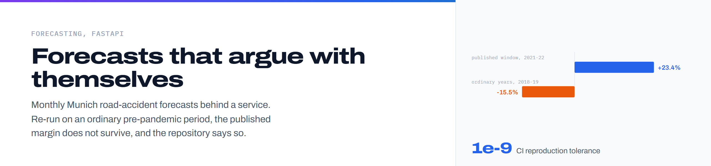

<picture>
  <source media="(prefers-color-scheme: dark)" srcset="docs/assets/header-dark.png">
  
</picture>

# Munich road accident forecasting

Monthly forecasts for the seven road accident series Munich publishes, fitted one
series at a time and served behind a small FastAPI service. It was written for the
Digital Product School coding challenge, then rebuilt after the first model turned
out not to work. The headline number below is also the number this repository
spends most of its effort arguing against, which is the part worth reading.

## The result, and the case against it

Held out: 2021 and 2022, 168 monthly observations, scored once. Errors are averaged
across the seven series after scaling each by its own level, so the small series are
not drowned out by the large ones.

| Method | Scaled MAE | MAPE |
| --- | --- | --- |
| Seasonal trend | **0.153** | **20.5%** |
| Seasonal naive | 0.200 | 25.4% |
| Series mean | 0.296 | 42.2% |

Seasonal naive repeats the same calendar month of the previous year. For seasonal
counts that is the comparison that matters, and the model beats it on all seven series.

That is where the write-up could have stopped. It does not, because the baseline on
this window carries 2020 forward, and 2020 was a pandemic year, so it forecasts low
on all seven series. Stating that caveat is not the same as measuring it. So the
identical protocol was run three years earlier, over a stretch where nothing unusual
happened: window selected on 2016 and 2017, refitted on everything to 2017, scored
once on 2018 and 2019. Same code, same metrics, same number of held-out rows. The
result is pinned in `results/pandemic_free_run.json`.

| Held out | Seasonal trend | Seasonal naive | Margin over the baseline | Series won |
| --- | --- | --- | --- | --- |
| 2021-2022, as published | **0.153** | 0.200 | +23.4% | 7 of 7 |
| 2018-2019, ordinary years | 0.166 | **0.143** | -15.5% | 3 of 7 |

The sign flips. `margin_share_lost` in that file is 1.662336, meaning the move to an
ordinary period costs more than the entire published margin. The point estimate has
the baseline ahead by 15.5%, and the model is in front on three of the seven
series rather than all seven.

### The caveat on that counter-result matters as much as the counter-result

Both rows rest on 24 months of seven series, and a single number says nothing about
whether it would hold on a different 24 months. A paired bootstrap answers that:
every method is scored on the same resampled months, so what varies is the margin
between them rather than the noise in each.

It is run twice. Drawing months independently assumes they carry no memory, which
for monthly accident counts is false and makes the interval too narrow. Drawing runs
of three consecutive months keeps short-range dependence inside each run. Neither is
right alone; where they disagree, believe the wider one.

| Held out | Margin | Months drawn independently | Drawn in blocks of three |
| --- | --- | --- | --- |
| 2021-2022, as published | +23.4% | [+10.8%, +35.0%] | [+7.2%, +33.3%] |
| 2018-2019, ordinary years | -15.5% | [-39.7%, +4.3%] | [-36.8%, +6.9%] |

The published margin clears zero on both. The earlier one does not: its interval
spans zero either way, so on 24 months the baseline's apparent 15.5% lead cannot be
told apart from no difference at all. Read neither row as settled. Do not read
-15.5% as "the baseline wins on ordinary years", and do not read +23.4% as a
property of the method.

What this repository can defend is narrower than either row and more useful than
both: the model's advantage is measurable on the published window and absent on an
ordinary one, and the gap between those two conclusions is the pandemic sitting in
the baseline's memory. The published figure is what happens when a trend fitted
through a collapse is scored against a baseline that repeats the collapse. Read it
as a measurement of 2021 and 2022.

That the comparison runs at all is the point of keeping the protocol in one place.
The published window is reproduced by the same function that produces the
pandemic-free one, so the two rows are not two scripts that happen to agree.

### The earlier window also fits a different model

The pre-pandemic run selects a 12-year trend window where the published run selects
6. Same selection procedure, different data, different fitted model. On its own
period that model is the more accurate of the two in absolute terms: MAPE 17.70%
against 20.48% on the published window. Only the margin over the baseline collapses.

<picture>
  <source media="(prefers-color-scheme: dark)" srcset="docs/figures/02_model_vs_baselines-dark.png">
  <source media="(prefers-color-scheme: light)" srcset="docs/figures/02_model_vs_baselines.png">
  
</picture>

## How to run it

Python 3.11, which is the version the CI workflow pins. Dependencies are pinned
exactly in `requirements.txt`.

```bash
pip install -r requirements.txt

# Reads the CSV, selects the trend window on the validation years, refits, scores
# against both baselines, writes models/forecaster.joblib and
# results/reference_run.json. A few seconds.
python -m accidents.pipeline

# The pandemic-free re-run and the bootstrap intervals, written to results/.
python -m accidents.robustness
python -m accidents.uncertainty

# Serve it.
uvicorn app:app --reload
```

To check the three runs against the committed artifacts instead of overwriting them,
add `--check` to any of the three module calls. That is what CI does: the workflow
`.github/workflows/tests.yml`, job `checks`, step "The pandemic-free re-run
reproduces too", runs `python -m accidents.robustness --check`. Every leaf of the
recomputed payload is compared against the stored one and any relative difference
above `TOLERANCE = 1e-9` fails the step. The tolerance is set at
`accidents/pipeline.py:105` and applied at `:133`. The environment block is excluded
from the comparison, since the Python version and the timestamp differ by machine.

Documentation is checked the same way. `scripts/check_claims.py` recomputes every
number this file publishes from `results/` and fails if the text no longer states
it, which is why the tables above are quoted to the digit.

```bash
pip install -r requirements-dev.txt

ruff check .
python -m pytest -q
python scripts/check_claims.py                   # 39 published claims
python scripts/figures/generate_figures.py       # figures regenerate from the run
```

## The API

| Endpoint | Purpose |
| --- | --- |
| `GET /` | Liveness, and whether the model artifact loaded |
| `GET /series` | The seven series that can be forecast, and the last year trained on |
| `POST /predict` | A forecast for one series, year and month |

```bash
curl -s -X POST localhost:8000/predict \
  -H 'Content-Type: application/json' \
  -d '{"category": "Alkoholunfälle", "kind": "insgesamt", "year": 2021, "month": 6}'
```

A request naming a series that does not exist returns 404 with the list of valid
ones, since a caller has no way to guess German category names. If the artifact is
missing the service reports that at `/` and returns 503 rather than pretending.

## Why this exists in its current form

The first version of this project fitted one linear regression to every row of the
city's export at once. That file holds seven different monthly series, three accident
categories crossed with an accident type, and their averages range from
21 to 3,512 accidents per month, a factor of 169. Fitting a single line through all
seven, with only a year and a month as input, produced a model with an R2 of 0.0009
and a mean absolute error of 824 against a target averaging 780. The API it served
accepted no way to say which series you wanted, and described its output as a number
of deaths, which is not a quantity the dataset contains.

That model is reproduced exactly in `docs/provenance.md` before anything was changed,
so the criticism is measured rather than asserted.

<picture>
  <source media="(prefers-color-scheme: dark)" srcset="docs/figures/01_series-dark.png">
  <source media="(prefers-color-scheme: light)" srcset="docs/figures/01_series.png">
  
</picture>

## The data

Munich publishes monthly road accident counts through its open data portal. The
snapshot used here is the May 2024 export, included in the repository as the
challenge input.

| | |
| --- | --- |
| Series | 7, being 3 categories crossed with an accident type |
| Observations | 1,932 monthly counts |
| Period | 2000 to 2022 |
| Categories | Alkoholunfälle, Fluchtunfälle, Verkehrsunfälle |
| Types | insgesamt, Verletzte und Getötete, mit Personenschäden |

Three details in the file matter and each is handled in `accidents/data.py`. `MONAT`
holds YYYYMM rather than a month number. Rows with `MONAT` set to `Summe` are annual
subtotals and would swamp the monthly series. Rows exist for 2023 and 2024 with no
values, because those months were not published, which is not the same thing as zero
accidents.

## The model

Each series is fitted separately, because they do not share a scale. Within a series
the model is a linear trend in time plus a monthly seasonal offset, fitted on the
most recent six years. Predictions are clipped at zero.

The six-year window is a choice, so it was made on 2019 and 2020 and the test years
were left alone. `docs/evaluation.md` records every window that was tried.

<picture>
  <source media="(prefers-color-scheme: dark)" srcset="docs/figures/03_forecast_vs_actual-dark.png">
  <source media="(prefers-color-scheme: light)" srcset="docs/figures/03_forecast_vs_actual.png">
  
</picture>

## Limitations

The test period is two years covering a pandemic and its rebound, which is an
unusual stretch to be judged on.

The model sees only its own history. There are no covariates for weather, traffic
volume, policy, road works or changes in reporting, so it cannot anticipate a change
in any of them.

This is a coding challenge exercise, not a public safety tool. Nothing here has been
validated for operational use, and the counts it forecasts are aggregates for a whole
city.

<details>
<summary>Why there is nothing here for a GPU to do</summary>

It runs on a CPU. The model is fitted on 1,764 monthly observations and the seven
fitted series together serialise to a few kilobytes. Fitting all seven takes
single-digit milliseconds and one forecast takes a small fraction of one, measured on
the author's machine and not pinned anywhere, because those are properties of the
machine. Moving arithmetic that size to an accelerator would cost more in transfer
than it replaced.

</details>

## Attribution

Data: Landeshauptstadt München open data portal, included as the challenge input and
not redistributed under any claim of ownership. Check the portal's current terms
before reuse.

The challenge framing is the Digital Product School's. The implementation and
evaluation are the author's own. `docs/provenance.md` separates the original
submission from the rebuild, and the original notebooks are preserved unmodified in
`notebooks/`.

## Licence

MIT for the code, see [LICENSE](LICENSE). The dataset is covered by its own terms.
